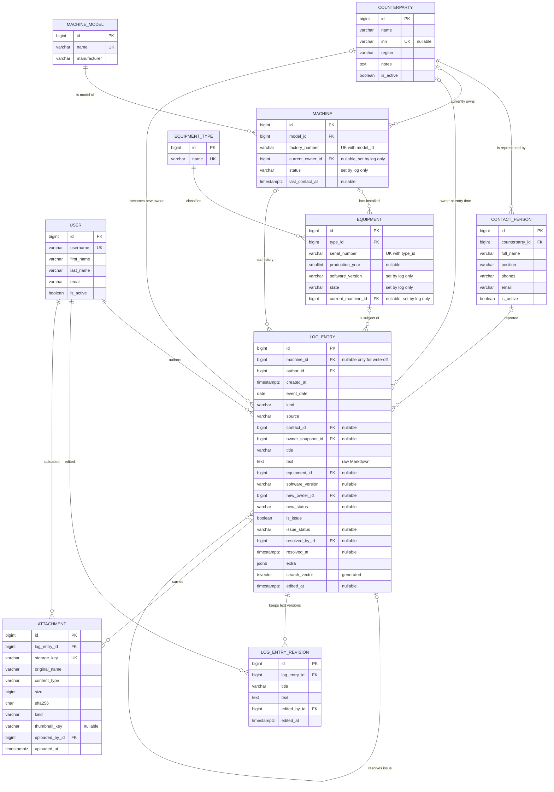

# ER model

Logical data model of TrackRecord for PostgreSQL 16 (ADR-0006). Terms are explained in
[DOMAIN.md](DOMAIN.md); the rules behind the constraints are in [ADR-0002](adr/0002-log-as-source-of-truth.md),
[ADR-0007](adr/0007-attachments-outside-db.md), [ADR-0008](adr/0008-markdown-free-text.md),
[ADR-0010](adr/0010-log-entry-revisions-table.md) and [ADR-0011](adr/0011-equipment-write-off-without-machine.md).
Table names are given without the Django app prefix (`core_`).

## Diagram

`USER` is Django's `auth_user`; roles are Django groups ("Engineer", "Administrator", ADR-0004)
linked through `auth_user_groups`. Ownership history of a machine is not a separate table: it is the
sequence of `ownership_change` log entries (and `owner_snapshot_id` on every entry).

## Enumerations

| Column | Values |
|---|---|
| `machine.status` | `in_service`, `under_repair`, `sold`, `decommissioned`, `unknown` |
| `equipment.state` | `in_stock`, `installed`, `removed`, `written_off` |
| `log_entry.kind` | `request` (call / request / info), `issue`, `maintenance` (maintenance / repair / remote consultation), `equipment_install`, `equipment_removal`, `equipment_write_off`, `software_update`, `ownership_change`, `status_change`, `document`, `initial_import` |
| `log_entry.source` | `phone`, `email`, `messenger`, `site_visit`, `remote`, `other` |
| `log_entry.issue_status` | `open`, `resolved` |
| `attachment.kind` | `photo`, `scan`, `video`, `audio`, `document` |

Stored as `varchar` with Django `TextChoices`; the allowed values are enforced with check constraints.

## Tables

### counterparty
Legal entity that owns machines; our customer.

| Column | Type | Notes |
|---|---|---|
| `id` | bigint | PK |
| `name` | varchar(255) | not null |
| `inn` | varchar(12) | taxpayer id, nullable; unique when not null |
| `region` | varchar(255) | free text, e.g. "Western Kazakhstan" |
| `notes` | text | default `''` |
| `is_active` | boolean | default true; counterparties are deactivated, not deleted |

### contact_person
Individual representing a counterparty (director, accountant, machine chief, crew chief).

| Column | Type | Notes |
|---|---|---|
| `id` | bigint | PK |
| `counterparty_id` | bigint | FK → counterparty, `ON DELETE PROTECT` |
| `full_name` | varchar(255) | not null |
| `position` | varchar(255) | default `''` |
| `phones` | varchar(255) | default `''` |
| `email` | varchar(254) | default `''` |
| `notes` | text | default `''` |
| `is_active` | boolean | default true |

### machine_model
Reference data, e.g. "Duomatic 09-32 CSM".

| Column | Type | Notes |
|---|---|---|
| `id` | bigint | PK |
| `name` | varchar(255) | unique |
| `manufacturer` | varchar(255) | default `''` |

### machine
A track maintenance machine. Model and factory number never change.

| Column | Type | Notes |
|---|---|---|
| `id` | bigint | PK |
| `model_id` | bigint | FK → machine_model, `PROTECT` |
| `factory_number` | varchar(64) | not null |
| `current_owner_id` | bigint | FK → counterparty, nullable, `PROTECT`; changed only by `ownership_change` entries |
| `status` | varchar(32) | enum; changed only by `status_change` entries |
| `last_contact_at` | timestamptz | nullable; updated by `request` entries |
| `created_at` | timestamptz | not null |

Constraints: `UNIQUE (model_id, factory_number)`.

### equipment_type
Reference data: controller, display, sensor, …

| Column | Type | Notes |
|---|---|---|
| `id` | bigint | PK |
| `name` | varchar(255) | unique |

### equipment
A unit of our equipment, identified by type and serial number.

| Column | Type | Notes |
|---|---|---|
| `id` | bigint | PK |
| `type_id` | bigint | FK → equipment_type, `PROTECT` |
| `serial_number` | varchar(128) | not null |
| `production_year` | smallint | nullable, `CHECK (production_year BETWEEN 1950 AND 2100)` |
| `software_version` | varchar(64) | default `''`; changed by `equipment_install` / `software_update` entries |
| `state` | varchar(32) | enum, default `in_stock`; changed only by log entries |
| `current_machine_id` | bigint | FK → machine, nullable, `PROTECT`; changed only by log entries |

Constraints:
- `UNIQUE (type_id, serial_number)`.
- `CHECK ((state = 'installed') = (current_machine_id IS NOT NULL))`: equipment is attached to a
  machine exactly when it is installed, so it can never be on two machines at once.

### log_entry
Anything that happened to a machine. Never deleted; state-changing columns are never updated after insert.
The only columns updated later are `issue_status`, `resolved_by_id`, `resolved_at` (when another entry
resolves the issue) and `title`, `text`, `edited_at` (author's amendment, old version kept in
`log_entry_revision`).

| Column | Type | Notes |
|---|---|---|
| `id` | bigint | PK |
| `machine_id` | bigint | FK → machine, nullable, `PROTECT`: only `equipment_write_off` may have no machine (ADR-0011) |
| `author_id` | bigint | FK → user, `PROTECT` |
| `created_at` | timestamptz | when the entry was recorded |
| `event_date` | date | when the event happened; may be earlier than `created_at` |
| `kind` | varchar(32) | enum |
| `source` | varchar(32) | enum |
| `contact_id` | bigint | FK → contact_person, nullable: who reported it |
| `owner_snapshot_id` | bigint | FK → counterparty, nullable: machine owner at the time of the entry |
| `title` | varchar(200) | not null |
| `text` | text | raw Markdown, default `''`, `CHECK (length(text) <= 50000)`, lz4 compression |
| `equipment_id` | bigint | FK → equipment, nullable |
| `software_version` | varchar(64) | nullable |
| `new_owner_id` | bigint | FK → counterparty, nullable |
| `new_status` | varchar(32) | nullable, enum of `machine.status` |
| `is_issue` | boolean | default false |
| `issue_status` | varchar(16) | nullable, enum |
| `resolved_by_id` | bigint | FK → log_entry, nullable: the entry that closed this issue |
| `resolved_at` | timestamptz | nullable |
| `extra` | jsonb | default `{}`; rare kind-specific attributes only, never used in rules or filters |
| `search_vector` | tsvector | `GENERATED ALWAYS AS (setweight(to_tsvector('russian', title), 'A') \|\| setweight(to_tsvector('russian', text), 'B')) STORED` |
| `edited_at` | timestamptz | nullable: last amendment of title or text |

Constraints (kind-specific fields):
- `machine_id IS NOT NULL OR kind = 'equipment_write_off'`.
- `kind IN ('equipment_install','equipment_removal','equipment_write_off','software_update')` ⇔ `equipment_id IS NOT NULL`.
- `kind IN ('equipment_install','software_update')` ⇒ `software_version IS NOT NULL`.
- `kind = 'ownership_change'` ⇔ `new_owner_id IS NOT NULL`.
- `kind = 'status_change'` ⇔ `new_status IS NOT NULL`.
- `is_issue` ⇔ `issue_status IS NOT NULL`; `issue_status = 'resolved'` ⇔ `resolved_by_id IS NOT NULL AND resolved_at IS NOT NULL`.
- `resolved_by_id <> id`.

Indexes:
- `(machine_id, event_date DESC)`: machine feed.
- `(machine_id) WHERE issue_status = 'open'`: open issues on the machine page.
- `(equipment_id, event_date DESC)`: equipment history.
- GIN on `search_vector`: full-text search in Russian.

### log_entry_revision
Previous versions of an entry's title and text when its author amends them (ADR-0008, ADR-0010).
`log_entry` itself is not tracked by `django-simple-history`.

| Column | Type | Notes |
|---|---|---|
| `id` | bigint | PK |
| `log_entry_id` | bigint | FK → log_entry, `PROTECT` |
| `title` | varchar(200) | value before the edit |
| `text` | text | value before the edit |
| `edited_by_id` | bigint | FK → user |
| `edited_at` | timestamptz | not null |

### attachment
Metadata of a file attached to a log entry. The file itself lives in storage, not in the database (ADR-0007).

| Column | Type | Notes |
|---|---|---|
| `id` | bigint | PK |
| `log_entry_id` | bigint | FK → log_entry, `PROTECT` |
| `storage_key` | varchar(255) | unique, `attachments/YYYY/MM/<uuid>.<ext>` |
| `original_name` | varchar(255) | used only in `Content-Disposition` |
| `content_type` | varchar(127) | detected from file content |
| `size` | bigint | bytes, `CHECK (size > 0)` |
| `sha256` | char(64) | integrity check |
| `kind` | varchar(16) | enum |
| `thumbnail_key` | varchar(255) | nullable |
| `uploaded_by_id` | bigint | FK → user |
| `uploaded_at` | timestamptz | not null |

## How current state is derived

| Log entry kind | Effect, applied in the same transaction by `create_log_entry()` |
|---|---|
| `request` | `machine.last_contact_at` |
| `issue` | `is_issue = true`, `issue_status = 'open'` on the new entry |
| `maintenance` | selected open issues get `issue_status = 'resolved'`, `resolved_by_id`, `resolved_at` |
| `equipment_install` | `equipment.state = 'installed'`, `current_machine_id`, `software_version` (row locked; rejected if not `in_stock` / `removed`) |
| `equipment_removal` | `equipment.state = 'removed'`, `current_machine_id = NULL` (only from the machine it is installed on) |
| `equipment_write_off` | `equipment.state = 'written_off'`, `current_machine_id = NULL` (machine required if the equipment is installed, and must be that machine) |
| `software_update` | `equipment.software_version` |
| `ownership_change` | `machine.current_owner_id` |
| `status_change` | `machine.status` |
| `document`, `initial_import` | none (import entries may set initial state) |
